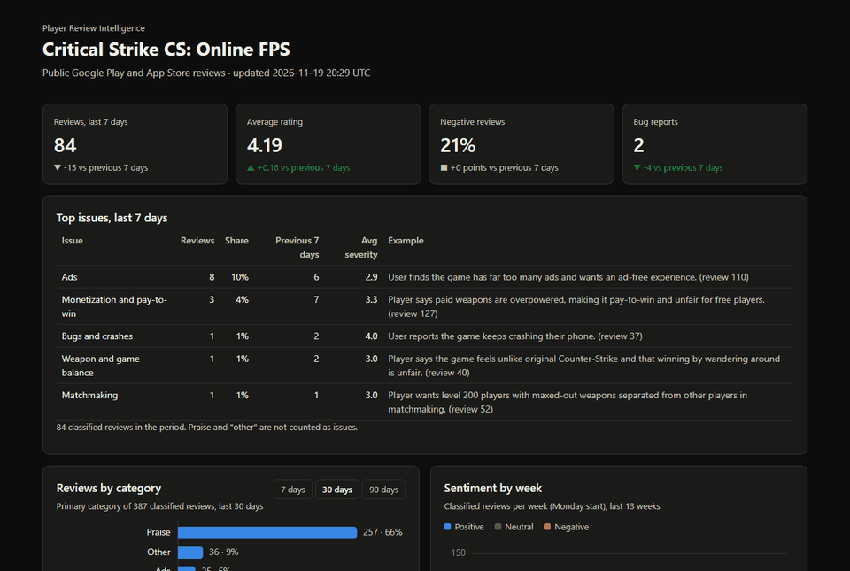
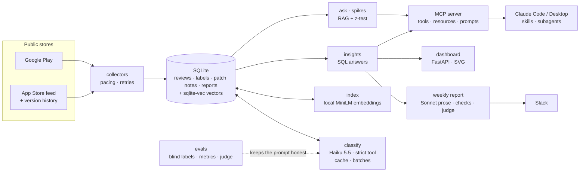

# Player Review Intelligence

[](https://github.com/LightWonkas/player-review-intelligence/actions/workflows/ci.yml)

Player Review Intelligence collects public app-store reviews for mobile games, classifies them with
Claude, links complaints to game updates with RAG, and serves the results as a weekly report, a
dashboard and an MCP server. Claude Code skills and subagents run the workflows on top.



## The problem

A live-service mobile game gets hundreds of store reviews a week across Google Play and the App
Store, in many languages, with a star rating that says little about *why*. The useful signals are
buried: an ad change that annoys players, a crash after an update, a weapon that feels pay-to-win.
Game teams usually find these late, by skimming. This project turns the review stream into numbers
a team can trust, plus a short weekly read that says what changed, what players say and who should
act. Every number comes from the database, never from the model.

Games are configured in [`config/apps.yaml`](config/apps.yaml); adding one needs no code changes.

## What it does

| Step | How | Measured on real data |
|---|---|---|
| Collect | Google Play scraper plus the App Store RSS feed: polite pacing, retries, idempotent upserts, no usernames stored | 950 reviews across both stores |
| Classify | `claude-haiku-5-5`, one strict tool call per review, Pydantic validation, prompt caching, Message Batches | 0.89 test accuracy against a stronger model's labels; ~$0.08 per 1,000 reviews |
| Evaluate | Blind reference labels, dev/test split, per-class P/R/F1, confusion matrix, Sonnet judge | README table updated by `eval --write-readme` |
| Link to releases | App Store version history, local embeddings in `sqlite-vec`, cited answers, per-store spike test | Answers cite real review ids and the right version |
| Report | Code computes the facts, Sonnet writes the prose, code checks it, a judge scores it | [Example report](docs/example-report.md), ~$0.03 each |
| Serve | FastAPI dashboard, MCP server (tools, resources, prompts), Slack webhook | Works in Claude Code via [`.mcp.json`](.mcp.json) |
| Automate | Claude Code skills and subagents in [`.claude/`](.claude/) | `/weekly-review-report`, `/add-new-game`, `/improve-classifier` |

## Architecture



Each module is described in two sentences in [`docs/ARCHITECTURE.md`](docs/ARCHITECTURE.md).

## Quickstart

Requires [uv](https://docs.astral.sh/uv/), which installs Python 3.12 for you. Only an
`ANTHROPIC_API_KEY` is needed.

```bash
git clone https://github.com/LightWonkas/player-review-intelligence && cd player-review-intelligence
uv sync
cp .env.example .env          # then set ANTHROPIC_API_KEY in .env
uv run review-intel fetch --app critical-strike --store all --limit 100
uv run review-intel classify --app critical-strike --limit 100     # ~$0.02
uv run review-intel report --app critical-strike --days 7          # ~$0.03
uv run review-intel dashboard                                      # http://127.0.0.1:8765
```

This exact sequence was run from a fresh clone. The database is created on first use, and every
command is safe to re-run. `uv run review-intel --help` lists the rest: `eval`, `label`,
`patches`, `index`, `ask`, `spikes`.

## Example report

[`docs/example-report.md`](docs/example-report.md) is a real report from the review data,
unedited. It has headline numbers against the previous week, the top issues with player quotes
and review ids, a version watch, a four-week sentiment table, prioritized actions for dev,
product and marketing, and the judge's score.

## Classification

Each review gets one strict tool call (`record_classification`) to `claude-haiku-5-5`. The result
is a primary category plus up to three more from the 12 in
[`config/taxonomy.yaml`](config/taxonomy.yaml), along with sentiment, severity (1-5), a
bug-report flag, mentioned features and a one-line summary.

- **Validation:** Pydantic checks every response. Invalid output is retried once and then kept in
  `classification_failures`, never dropped.
- **Untrusted input:** Review text goes in as escaped data inside `<review>` tags, and a test
  checks that a malicious review can't break out.
- **Prompt versions:** `prompt_version` (e.g. `v1-10aea4a5`) is a hash of the prompt and tool
  schema, so editing either creates a new version and results never mix.
- **Cost:** The ~1,900-token shared prefix is prompt-cached, so each review pays for about 300
  input and 210 output tokens. `classify --dry-run` prints the count and the estimated cost
  before you spend anything.

## Evals

The reference set has 100 reviews, labeled blind: the labeler never sees the model's answer. The
current labels were set by `claude-opus-5-5`, a stronger model than the classifier, and recorded
per item in the `labeler` field. So the scores measure agreement with a stronger reference, not
human accuracy; `review-intel label` lets a person relabel or extend the set.

The sample is 40% random (mostly praise, like the real mix) and 60% low-rated reviews with real
text, where the hard categories are, with at least 25% from the App Store. A hash of each review
fixes it in a 70/30 dev/test split: prompts are tuned on dev, and the headline number is test.
With 35 test reviews, one review moves accuracy by about 3 points.

`review-intel eval` reports:

- primary-category accuracy, per-category precision/recall/F1 and macro-F1
- sentiment accuracy and a confusion matrix
- a comparison with the previous prompt or model
- an LLM judge's faithfulness score for the per-review summaries (`claude-sonnet-5-5`)

Predictions are cached per prompt version, so re-running an unchanged prompt is free.

<!-- eval:start -->
| Date | Prompt | Model | Test acc | Test macro-F1 | Sentiment acc (all) | Judge |
|---|---|---|---:|---:|---:|---:|
| 2026-11-19 | `v1-10aea4a5` | claude-haiku-5-5 | 0.89 (n=35) | 0.70 | 0.97 | 4.65/5 |
<!-- eval:end -->

The weakest spot is the game's own auto-aim, which gets read as cheating
(`controls_ux -> cheating_hackers`). The [`improve-classifier`](.claude/skills/improve-classifier/SKILL.md)
skill is built for exactly this kind of fix.

## Linking complaints to releases (RAG)

```bash
uv run review-intel patches fetch --app critical-strike   # release notes, one request
uv run review-intel index --app critical-strike           # local embeddings, free
uv run review-intel ask "When did matchmaking complaints start?" --app critical-strike
uv run review-intel spikes --app critical-strike
```

- **Patch notes:** The App Store page lists the last ~25 versions with dates and notes, the only
  public release history with dates. Notes for other stores can be imported from markdown
  (`patches import`). Version numbers are shared across stores, so one note serves both.
- **Embeddings:** Reviews and single patch-note lines are embedded locally with
  `all-MiniLM-L6-v2` and stored in `sqlite-vec` tables in the same SQLite file, so search results
  join straight back to SQL. Re-indexing only embeds changed text.
- **`ask`:** Retrieves similar reviews and patch notes, adds the notes for the versions those
  reviews were written on, and adds a per-version timeline from SQL. Sonnet answers and cites
  `[r<id>]` and `[v<version>]`. Every citation is checked against what was retrieved; invented
  ones are removed and reported. Asked when complaints about a new weapon started, it named the
  release that added the weapon and the earliest review that mentions it.
- **`spikes`:** No LLM is involved. Per store, a version's share of reviews mentioning a category
  is compared with the previous versions using a two-proportion z-test. Stores are kept apart, so
  a shift in store mix can't fake a spike. Each spike links to the patch note in force, with its
  lines ranked by similarity to the complaints. When nothing is significant, the closest
  candidates are shown and labeled as not significant.

## Weekly report and dashboard

Code lays out the report and fills in every number. `claude-sonnet-5-5` writes only the prose, as
structured output, and code then checks it:

- **Numbers:** every number in the prose must appear in the facts the model was given. If one
  doesn't, the model gets one retry with the offending numbers listed.
- **References:** review ids and categories that weren't in the facts are dropped.
- **Judge:** a separate call scores the prose for faithfulness, and the score goes in the footer.

On real data the first version scored 2/5: it said "players say" on the strength of one review,
and it treated an old version as current. Fixing the facts (per-store versions, marked partial
weeks, the severity scale) and asking for claims sized to their evidence brought it to 4/5.

The dashboard is FastAPI and Jinja2 with server-side SVG charts and no JavaScript. It shows
7-day stat tiles, top issues, reviews by category (7/30/90 days), weekly sentiment and the latest
report. Every chart has a table view, and both color modes were run through a color-vision
deficiency check. JSON routes live under `/api/apps/{app}/...`. The dashboard is read-only and
listens on localhost.


## MCP server

`review-intel-mcp` serves the data over the [Model Context Protocol](https://modelcontextprotocol.io)
with the official Python SDK (`MCPServer`, the SDK 2.x name for FastMCP). It runs over stdio, or
over streamable HTTP with `--transport streamable-http`.

| Kind | Name | What it does |
|---|---|---|
| Tool | `top_issues(app, days, limit)` | Top complaint categories vs the previous period, with example reviews |
| Tool | `sentiment_trend(app, days, bucket)` | Sentiment and average rating per day or week |
| Tool | `compare_versions(app, version_a, version_b)` | Category shares with z-scores, rating, sentiment and patch notes |
| Tool | `search_reviews(app, query, category?, version?, limit)` | Semantic search with filters |
| Tool | `ask(app, question)` | Cited answer (calls Claude, ~$0.014) |
| Resource | `reviews://{app}/{review_id}`, `reports://{app}/latest`, `taxonomy://categories` | One review, the latest report, the categories |
| Prompt | `weekly_report(app)`, `triage_bugs(app, days)` | Step-by-step plans that use the tools |

All tools except `ask` are read-only and free, and they share the [`insights`](src/review_intel/insights.py)
query layer with the report and the dashboard, so all three show the same numbers.

**Claude Code:** a session opened in this folder picks up [`.mcp.json`](.mcp.json); approve it
once. To add the server elsewhere:
`claude mcp add --transport stdio review-intel -- uv run --directory /path/to/repo review-intel-mcp`.

**Claude Desktop:** add this to `claude_desktop_config.json`:

```json
{
  "mcpServers": {
    "review-intel": {
      "command": "uv",
      "args": ["run", "--directory", "C:\\path\\to\\player-review-intelligence", "review-intel-mcp"]
    }
  }
}
```

**Inspector:** `npx @modelcontextprotocol/inspector uv run review-intel-mcp`

## Claude Code skills and subagents

The repo uses Claude Code to operate the system, not just to build it.

| | Name | What it does |
|---|---|---|
| Skill | [`weekly-review-report`](.claude/skills/weekly-review-report/SKILL.md) | Fetch, classify and report for a game, then summarize. Prices each paid step before running it. |
| Skill | [`add-new-game`](.claude/skills/add-new-game/SKILL.md) | Adds a game to the config, checks both store ids against the stores, fetches a sample. |
| Skill | [`improve-classifier`](.claude/skills/improve-classifier/SKILL.md) | Eval, confusion matrix, one proposed change shown as a diff, re-eval, before/after table. |
| Subagent | [`bug-analyst`](.claude/agents/bug-analyst.md) | Deduplicated bug list with versions, severity and example review ids. |
| Subagent | [`sentiment-analyst`](.claude/agents/sentiment-analyst.md) | Sentiment by week and version, backed by numbers. |
| Subagent | [`report-reviewer`](.claude/agents/report-reviewer.md) | Checks a report's quotes and claims against the data before it is shared. |

Each subagent only gets the free, read-only MCP tools. [`CLAUDE.md`](CLAUDE.md) gives every
session the commands, the conventions and the rule: run tests and evals before claiming a change
works.

## Cost

Prices as of November 2026 ([`pricing.py`](src/review_intel/llm/pricing.py)); check Anthropic's
pricing page before budgeting.

| What | Model | Cost |
|---|---|---:|
| Classify 1,000 reviews, `--batch` | Haiku 5.5 | ~$0.08 |
| Classify 1,000 reviews, synchronous | Haiku 5.5 | ~$0.17 |
| Weekly report, with judge | Sonnet 5.5 | ~$0.03 |
| `ask`, one question | Sonnet 5.5 | ~$0.014 |
| Eval run (100 labels + 20 judged summaries) | Haiku + Sonnet | ~$0.08; ~$0.06 when cached |
| Embeddings and index (950 reviews in 19 s on CPU) | local MiniLM | $0 |

A game with 1,000 new reviews a week costs about **$0.11 per week**: a batch classification plus
one report. All the live runs behind this README cost under $1 in total.

## Design decisions

- **Haiku to classify, Sonnet to write and judge.** Classification is high-volume and narrow, and
  Haiku 5.5 reaches 0.89 test accuracy at about $0.08 per 1,000 reviews. Prose a product manager
  forwards, and grading other models' output, need the stronger model. The judge is never the
  model it grades.
- **Tool use for structured output.** One forced, strict tool call with enum categories gives
  parseable JSON every time, and Pydantic covers what JSON Schema can't express. Results are
  keyed by prompt version and model, so comparisons stay clean.
- **Code computes, the model writes.** Every number in a report, answer or dashboard comes from
  SQL. The model's prose is checked for numbers and ids that aren't in the facts, and a judge
  scores what's left. This is what makes the report safe to forward.
- **Local embeddings in the same database.** MiniLM on CPU is free, keeps review text on the
  machine, and needs no second vendor. `sqlite-vec` keeps vectors next to the rows they describe,
  so retrieval joins straight back to SQL. The trade-off is an English-focused model, which is one
  setting to change.
- **Evals keep the prompt honest.** Labels are blind, the dev/test split is fixed by hash, and
  predictions are cached per prompt version. The README table updates from real runs, so any
  prompt change shows up as a number before it ships.
- **Untrusted input everywhere.** Review text is escaped and delimited in every prompt, flattened
  and escaped in reports, and autoescaped in the dashboard. Tests cover injection attempts at each
  layer.
- **Statistics before stories.** Spikes need a z-score and a minimum sample, per store. With
  today's data that honestly means "no significant spikes" plus the closest candidates, rather
  than a confident narrative.

## Limitations and next steps

- **Reference labels come from a stronger model, not people.** A human-labeled set would measure
  real accuracy (`review-intel label` is ready for it).
- **Shallow history.** The App Store feed serves only ~500 recent reviews per country, and
  fetching newest-first covers a few weeks of Google Play. With ~20 reviews per version, spikes
  rarely reach significance. A scheduled weekly fetch would build the history.
- **One storefront.** Only the US store is tracked. Other countries are a config entry each, and
  multilingual reviews would want a multilingual embedding model (`EMBEDDING_MODEL`).
- **Judge scores vary.** Scores for the same week ranged from 3/5 to 4/5 between runs. The
  `report-reviewer` subagent is the second check before sharing.
- **SQLite.** SQL works on Postgres through `DATABASE_URL`, but vector search uses `sqlite-vec`;
  pgvector would be the move for a shared deployment.
- **Next steps:** human labels, a scheduled pipeline with Slack alerts when a spike becomes
  significant, and more storefronts.

## Development

```bash
uv run pytest                                     # 210 tests, no network, no real LLM
uv run ruff check . && uv run ruff format --check .
uv run mypy                                       # strict
uv run python scripts/record_fixtures.py          # re-record store fixtures (by hand)
uv run scripts/make_demo_gif.py                   # rebuild docs/demo.gif from a running dashboard
```

CI runs ruff, mypy and pytest on every push. The full build plan is in [`docs/SPEC.md`](docs/SPEC.md).
